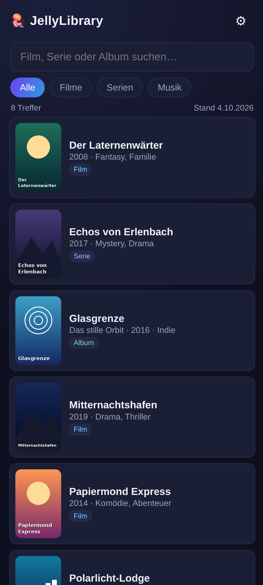
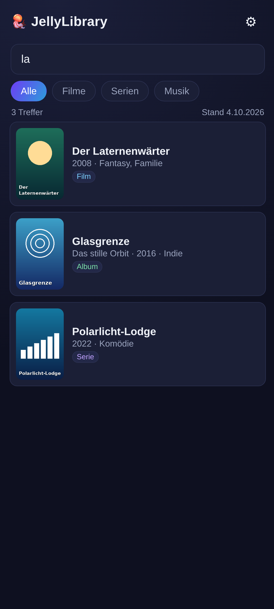
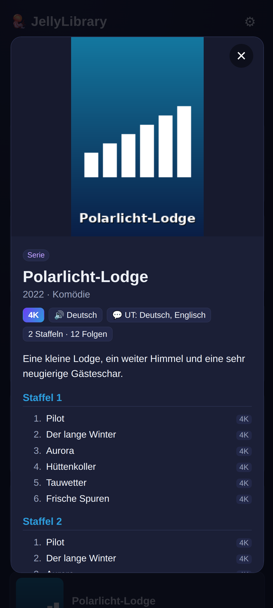
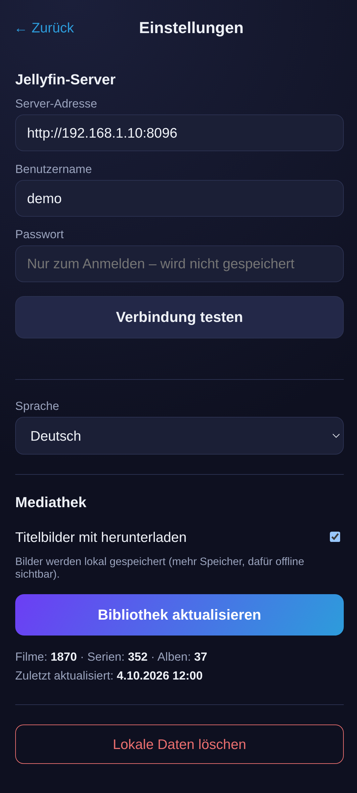

# JellyLibrary

[English version](README.md)

Eine **Offline-Suche für die eigene [Jellyfin](https://jellyfin.org)-Mediathek**.
Einmal zu Hause mit dem Jellyfin-Server verbinden, die Liste aller Filme, Serien
und Musik-Alben (optional mit Titelbildern) in eine lokale IndexedDB laden – und
danach jederzeit ohne Netz durchsuchen.

Typischer Einsatz: im Laden stehen und wissen wollen, ob man einen Film schon besitzt.

## Screenshots

   

## Funktionen

- Offline-Suche über Filme, Serien und Musik-Alben
- Auflösung (4K / 1080p / 720p / DVD / SD), Audio- und Untertitel-Sprachen pro Titel
- Staffeln und Folgen für jede Serie
- Optional lokale Titelbilder
- Funktioniert mit **Jellyfin 12** (moderner `Authorization`-Header; die alten
  `X-Emby-*`-Header sind dort standardmäßig abgeschaltet)
- Das **Passwort wird nie gespeichert** – nur das Zugriffstoken
- Oberfläche auf Deutsch und Englisch (Systemsprache, Fallback Englisch); weitere
  Sprachen leicht ergänzbar
- Kein Tracking, keine Werbung, keine Google-Dienste

> Titel, Beschreibungen und Genres werden so angezeigt, wie sie der Server liefert –
> in der in Jellyfin eingestellten Metadatensprache.

## Benutzung

1. **Einstellungen** öffnen, Server-Adresse (z. B. `http://192.168.1.10:8096`),
   Benutzername und Passwort eintragen, **Verbindung testen**.
2. **Bibliothek aktualisieren** (bei sehr großen Bibliotheken vorher die Titelbilder
   abschalten – ~2000 Poster sind grob 100 MB).
3. Suchen. Ab jetzt funktioniert alles offline.

`http://`- und `https://`-Server funktionieren. Bei HTTPS muss das Zertifikat von
Android akzeptiert werden (z. B. Let's Encrypt); selbstsignierte Zertifikate werden abgelehnt.

## Bauen

Web-App (reines HTML/CSS/JS, kein Framework), mit [Capacitor](https://capacitorjs.com) 6
für Android gewrappt.

Voraussetzungen: Node.js 18+, JDK 17, Android SDK (Plattform 35).

```sh
npm install
npx cap sync android
cd android && ./gradlew assembleDebug
# -> android/app/build/outputs/apk/debug/app-debug.apk
```

## Neue Sprache hinzufügen

`www/lang/en.js` nach `www/lang/<code>.js` kopieren, übersetzen und eine
`<script src="lang/<code>.js">`-Zeile in `www/index.html` ergänzen. Die Sprache
erscheint automatisch in den Einstellungen.

## KI-Unterstützung

Diese App wurde mit Hilfe eines KI-Coding-Assistenten (Claude Code von Anthropic)
entwickelt.

## Lizenz

[GPL-3.0-or-later](LICENSE) © Stevie4Ever
