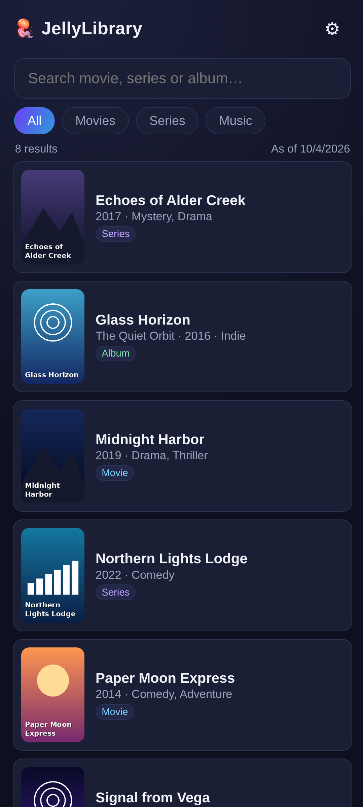
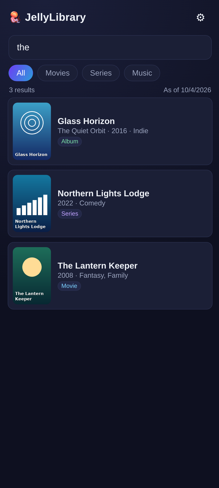
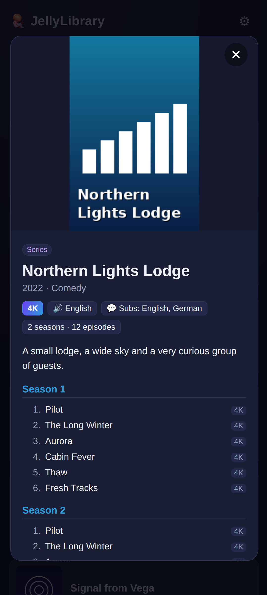
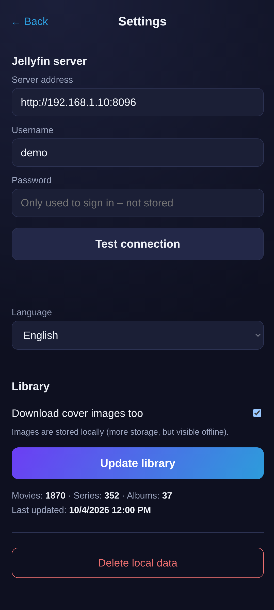

# JellyLibrary

[Deutsche Version](README.de.md)

An **offline search for your own [Jellyfin](https://jellyfin.org) library**. Connect
once to your Jellyfin server at home, let the app download the list of all your
movies, series and music albums (optionally with cover images) into a local
IndexedDB, and search it any time – without a network connection.

Typical use: standing in a shop, wondering whether you already own a movie.

## Screenshots

   

## Features

- Offline search over movies, series and music albums
- Resolution (4K / 1080p / 720p / DVD / SD), audio and subtitle languages per title
- Seasons and episodes for every series
- Optional local cover images
- Works with **Jellyfin 12** (uses the modern `Authorization` header; the legacy
  `X-Emby-*` headers are disabled by default there)
- Your **password is never stored** – only the access token
- English and German UI (system language, English fallback); more languages are
  easy to add
- No tracking, no ads, no Google services

> Titles, descriptions and genres are shown exactly as delivered by your server, in
> the metadata language configured in Jellyfin.

## Usage

1. Open **Settings**, enter server address (e.g. `http://192.168.1.10:8096`),
   username and password, and tap **Test connection**.
2. Tap **Update library** (turn off cover images first if your library is huge –
   ~2000 posters are roughly 100 MB).
3. Search. Everything works offline from now on.

Both `http://` and `https://` servers work. For HTTPS the certificate must be
trusted by Android (e.g. Let's Encrypt); self-signed certificates are rejected.

## Building

A web app (plain HTML/CSS/JS, no framework) wrapped with
[Capacitor](https://capacitorjs.com) 6 for Android.

Requirements: Node.js 18+, JDK 17, Android SDK (platform 35).

```sh
npm install
npx cap sync android
cd android && ./gradlew assembleDebug
# -> android/app/build/outputs/apk/debug/app-debug.apk
```

For pure web changes a local server is enough: `cd www && python3 -m http.server 8177`.

## Adding a language

Copy `www/lang/en.js` to `www/lang/<code>.js`, translate the strings, and add a
`<script src="lang/<code>.js">` line to `www/index.html`. The language shows up in
the settings automatically and is picked when it matches the system language.

## AI assistance

This app was developed with the help of an AI coding assistant (Claude Code by
Anthropic).

## License

[GPL-3.0-or-later](LICENSE) © Stevie4Ever
